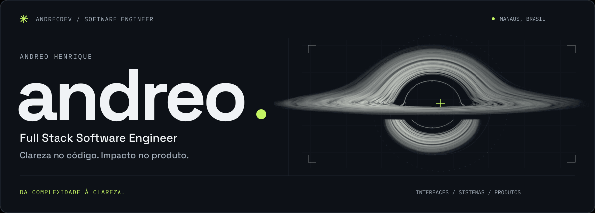
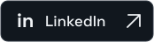
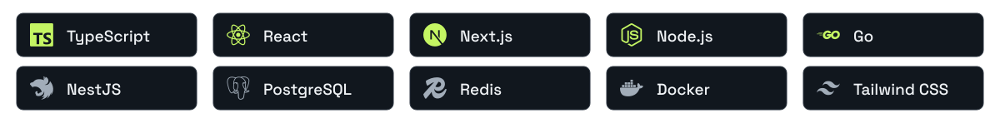
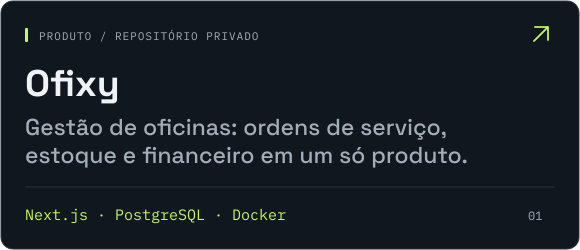
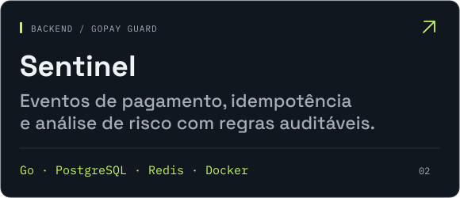

  <picture>
    <source media="(max-width: 600px) and (prefers-reduced-motion: reduce)" srcset="./assets/hero-mobile.png" />
    <source media="(prefers-reduced-motion: reduce)" srcset="./assets/hero.png" />
    <source media="(max-width: 600px)" srcset="./assets/hero-mobile.gif" />
    
  </picture>

  
  
  

### Transformo regras complexas em produtos que funcionam.

Desenvolvo produtos web de ponta a ponta: interfaces, APIs, dados e integrações. Experiência com fintech, Pix, SaaS multi-tenant e automações com IA.

**Por onde passei** &nbsp; Wite Group · InovStar · Planno Finanças 
**Busco oportunidades** &nbsp; Frontend · Full Stack · Backend

### Stack principal

<picture>
  <source media="(max-width: 600px)" srcset="./assets/stack-mobile.svg" />
  
</picture>

### Do produto ao código

  
  

  Explore também &nbsp; <a href="https://github.com/andreodev/FoodBox" title="React Native e Firebase">FoodBox</a> &nbsp;·&nbsp; <a href="https://github.com/andreodev/Takusan" title="React e GraphQL">Takusan</a> &nbsp;·&nbsp; <a href="https://github.com/andreodev/rest-go" title="Go">rest-go</a> &nbsp;·&nbsp; <a href="https://github.com/andreodev/port-main" title="React e Tailwind CSS">port-main</a>

  Feito em Manaus. Pensado para ir além. &nbsp;↗&nbsp; <a href="https://andreodev.vercel.app/">Conheça meu trabalho</a>

